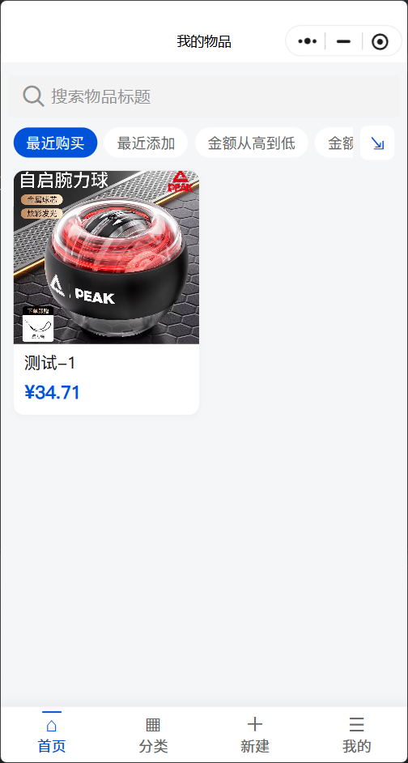
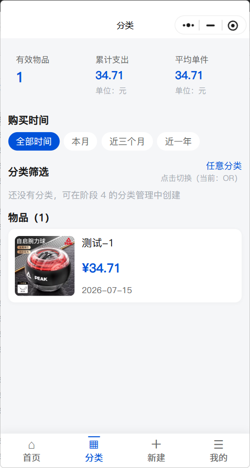

# 购买产品图文展示小程序

一个基于 **微信原生小程序 + TypeScript + TDesign** 的物品图文档案管理应用，用于记录购买物品的封面/详情图片、金额、购买信息与多级分类，并支持数据统计、图片缓存以及本地 / WebDAV 云端备份。


## 界面预览

| 首页 | 分类 |
|:---:|:---:|
|  |  |

## 功能特性

- **物品档案管理**：新建、编辑、详情、复制，以及软删除（回收站可恢复）。
- **图文展示**：封面图 + 多张详情图，点击即可大图预览；图片本地缓存、按需加载。
- **购买信息记录**：实际支付金额、数量、单件均价、购买时间、购买平台、订单编号、商品链接。
- **多级分类**：物品与分类多对多关联，支持分类管理（增删改）。
- **数据统计**：有效物品数、累计支出、平均单件支出、各分类计数与金额，口径全站统一。
- **图片缓存**：URL 经 FNV-1a 哈希派生文件名，按需下载、并发受限、可手动清空。
- **本地备份与恢复**：导出 / 从微信会话导入 JSON、整库恢复；恢复前自动生成保护点，支持「撤销上次恢复」一键回滚；本地备份快照自动轮转，仅保留最近 3 份。
- **WebDAV 云端备份**：支持坚果云等 WebDAV 服务，云端双 manifest + SHA-256 回读校验 + 最近 3 份轮转；上传失败自动清理云端新文件，索引损坏时中止并提示。
- **数据安全**：A/B 双版本本地数据库交替写入，revision 版本控制，损坏自动回退。

## 技术栈

- 微信原生小程序（`glass-easel` 组件框架，基础库 3.18.0）
- TypeScript 5.9
- TDesign MiniProgram 组件库
- 自定义 tabBar
- 本地文件系统存储（`wx.env.USER_DATA_PATH`，非云开发）

## 目录结构

```
miniprogram-3/
├── miniprogram/              # 小程序源码
│   ├── app.ts / app.json / app.wxss
│   ├── pages/                # 页面
│   │   ├── home/             #   首页（物品列表 + 统计）
│   │   ├── category/         #   分类浏览
│   │   ├── create/           #   新建物品
│   │   ├── mine/             #   我的（备份 / 缓存 / 配置入口）
│   │   ├── item-detail/      #   物品详情
│   │   ├── item-edit/        #   物品编辑
│   │   ├── category-manage/  #   分类管理
│   │   ├── recycle-bin/      #   回收站
│   │   ├── image-cache/      #   图片缓存
│   │   ├── backup/           #   备份与恢复
│   │   └── webdav-config/    #   WebDAV 配置
│   ├── components/           # 通用组件（item-card / item-form / empty-state 等）
│   ├── services/             # 服务层（物品 / 分类 / 统计 / 备份 / WebDAV / 图片缓存）
│   ├── repositories/         # 仓储层（数据访问）
│   ├── storage/              # 存储层（文件系统 + Storage 封装、A/B 双库）
│   ├── models/               # 数据模型
│   ├── utils/                # 工具（金额 / 日期 / 哈希 / 校验 / 提示）
│   ├── constants/            # 常量（路由 / 存储键 / 图片前缀）
│   └── custom-tab-bar/       # 自定义底部导航
├── docs/
│   ├── img/                  # 文档预览图
│   └── 分类标签参考.md       # 常用分类标签建议
├── typings/                  # 全局类型定义
├── package.json
├── project.config.json
└── tsconfig.json
```

## 快速开始

### 环境要求

- [微信开发者工具](https://developers.weixin.qq.com/miniprogram/dev/devtools/download.html)
- Node.js（用于安装依赖）

### 运行步骤

1. 克隆并安装依赖：

   ```bash
   git clone <repository-url>
   cd miniprogram-3
   npm install
   ```

2. 用微信开发者工具导入项目根目录，在「详情 → 本地设置」中填入你自己的 AppID。

3. 构建 npm 依赖（工具 → 构建 npm），使 `tdesign-miniprogram` 生效。

4. 编译运行即可。TypeScript 由微信开发者工具的编译器插件（`useCompilerPlugins: typescript`）自动编译。

> 也可直接运行 `npm run tsc:check` 做类型检查。

## 数据存储与备份

- **本地存储**：业务数据写入用户文件系统（`USER_DATA_PATH`），采用 A/B 双副本 JSON 数据库交替安全写入，写入后回读校验，任一副本损坏自动回退另一副本，双库损坏时停止写入以保护数据。
- **本地备份**：支持导出 / 从微信会话导入 JSON 备份文件并进行整库恢复；每次恢复前自动把当前库写入 `data/pre-restore.json` 作为保护点，备份页可「撤销上次恢复」一键回滚。本地备份快照自动轮转，仅保留最近 3 份，异常中断残留的临时文件也会顺带清理。
- **WebDAV 云端备份**：支持坚果云等 WebDAV 服务，云端以 A/B 双 manifest + SHA-256 回读校验 + 最近 3 份轮转保证一致性。上传任意环节失败会删除刚写入的云端文件；manifest 读取区分「不存在 / 内容损坏 / 网络或鉴权失败」，两份索引均损坏时中止并提示，避免误重建导致旧备份失联。

## 分类标签参考

新建分类时可参考 [docs/分类标签参考.md](docs/分类标签参考.md)，内置 20 余个常用四字标签与数十个两字标签，可直接挑选使用。

## 分层架构

```
Page（页面/交互）
   └── Service（业务逻辑与校验）
         ├── Repository（数据读写）
         │      └── Storage（文件系统 / Storage 封装）
         └── Model（类型定义）
```

页面不直接操作文件系统或 Storage，统一经 Repository / Storage 层实现，保证数据一致性与可测试性。

## License

本项目采用 [MIT License](LICENSE)。
